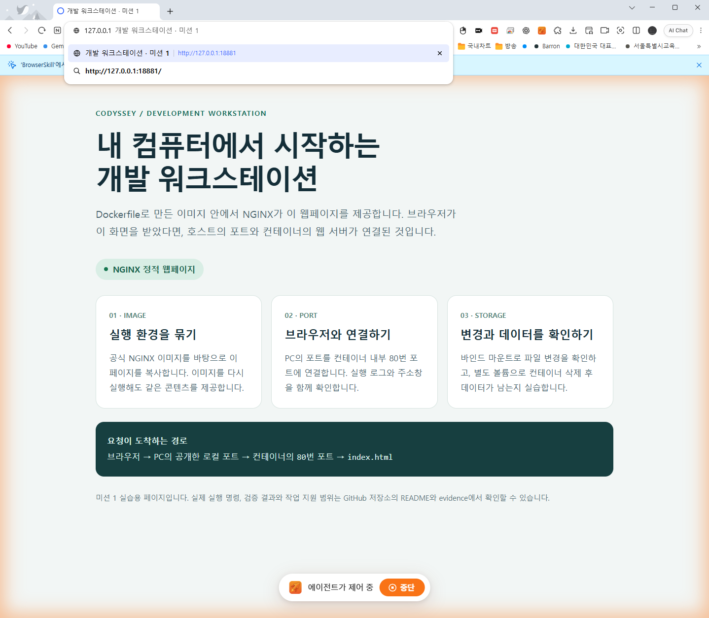

# 개발 워크스테이션 환경 구축

터미널로 파일과 권한을 다루고, Dockerfile로 웹 서버를 만든 뒤 포트 연결과 데이터 보존을 실제로 검증한 기록입니다.

- GitHub: [pjmin19/dev-workstation-mission](https://github.com/pjmin19/dev-workstation-mission)
- 실습 검증일: **2026년 10월 29일, 한국 시간**
- 작성·실행 지원: 사용자 요청에 따라 **Codex가 코드 작성, CLI 실습 실행, 증거 수집과 문서화를 수행**했습니다.
- 현재 상태: 아래 환경의 실습 검증 완료. 코디세이 동료평가와 본인의 독립 재실행·설명은 별도로 진행합니다.

## 1. 실행 환경

이미 설치된 도구를 확인해서 사용했습니다. 새로 설치했다고 기록하지 않았습니다.

| 항목 | 확인한 환경 |
|---|---|
| 호스트 | Windows 11 Home, 빌드 22621 |
| 실행 쉘 | PowerShell 7.6.5 |
| Linux 터미널 | WSL 2의 Ubuntu 24.04 LTS, Bash 5.2.21 |
| Docker Desktop | 4.71.0 |
| Docker 클라이언트 / Linux 엔진 | 29.4.1 / 29.4.1 |
| Windows Git | 2.52.0.windows.1 |
| GitHub CLI | 2.92.0, 인증 계정 pjmin19 |
| VSCode | GitHub 계정 pjmin19와 이 저장소의 main 브랜치 연결 확인 |

[환경 확인 명령과 실제 출력](evidence/01-environment.md)을 참고합니다. Linux 권한 실습은 WSL의 `/tmp`에서, Docker 명령은 Windows의 Docker Desktop `desktop-linux` 연결에서 실행했습니다. WSL에 따로 설치된 Docker CLI 버전과 Windows CLI 버전을 혼동하지 않습니다.

## 2. 수행 체크리스트와 증거

체크 표시는 이번 PC에서 명령을 실행하고 결과를 확인했다는 뜻입니다.

| 확인 | 수행 항목 | 실제 증거 |
|---|---|---|
| [x] | 현재 위치·숨김 파일·폴더 이동·생성·복사·이름 변경·삭제·내용 확인·빈 파일 생성 | [터미널 로그](evidence/02-terminal-permissions.md) |
| [x] | 파일 644 → 755, 폴더 755 → 700 권한 변경 | [권한 변경 전후](evidence/02-terminal-permissions.md) |
| [x] | Docker 버전과 엔진 동작, 이미지 다운로드·목록 | [Docker 로그](evidence/03-docker-lab.md) |
| [x] | hello-world, Ubuntu 내부 ls·echo, exec·attach 관찰 | [Docker 로그](evidence/03-docker-lab.md) |
| [x] | 직접 작성한 Dockerfile 빌드와 웹 서버 실행 | [Dockerfile](Dockerfile), [웹 소스](site/index.html) |
| [x] | 서로 다른 호스트 포트 2개에서 HTTP 200 | [포트 18881 화면](evidence/web-18881.png), [포트 18882 화면](evidence/web-18882.png) |
| [x] | 바인드 마운트의 호스트 변경 반영 | [변경 전후 로그](evidence/03-docker-lab.md) |
| [x] | named volume의 컨테이너 삭제 전후 데이터 유지 | [데이터 해시와 본문](evidence/03-docker-lab.md) |
| [x] | ps -a·logs·stats·stop 운영 명령 | [운영 로그](evidence/03-docker-lab.md) |
| [x] | Git 사용자·기본 브랜치 설정, VSCode GitHub 계정·저장소 연결 | [Git 증거](evidence/04-git-vscode.md), [VSCode 실제 UI 읽기](evidence/04-vscode-native-readback.json) |
| [x] | 실패 원인과 해결 과정 정리 | 아래 7절과 [실패 시도 원본](evidence/attempts/) |

실행 결과 요약은 [05-results.json](evidence/05-results.json)에 있습니다. 실패 시도를 최종 성공 로그와 구분해서 보존했습니다. 텍스트 로그는 게시를 위해 줄바꿈을 LF로 통일하고 행 끝 공백만 정리했으며, 명령과 출력 내용은 유지했습니다.

## 3. 파일 구성

```text
.
├── Dockerfile
├── .dockerignore
├── .gitignore
├── site/
│   └── index.html
├── scripts/
│   ├── terminal-lab.sh       # Linux 터미널·파일 권한 실습
│   └── Run-DockerLab.ps1    # Docker 실습과 검증·작업 자원 정리
├── evidence/               # 명령·출력·원본 화면·검증 결과
└── README.md
```

`.lab/`은 재실행 때 생성되는 로컬 작업 폴더이며 Git과 Docker 빌드에서 제외했습니다. 코디세이의 원문 자료, 비밀번호, 토큰과 개인키는 제출 파일에 포함하지 않습니다.

## 4. 평가자가 따라 할 실행 방법

### 준비

Docker Desktop의 Linux 엔진이 실행된 Windows + PowerShell 7 환경을 기준으로 합니다. 기존 저장소가 있으면 그 폴더에서 시작합니다.

```powershell
git clone https://github.com/pjmin19/dev-workstation-mission.git
cd dev-workstation-mission
docker --version
docker info
```

### 웹 서버만 실행하기

```powershell
docker build -t codyssey-workstation:manual .
docker run -d --rm --name codyssey-m1-manual -p 127.0.0.1:18881:80 codyssey-workstation:manual
curl.exe --connect-timeout 3 --max-time 8 http://127.0.0.1:18881/
```

브라우저에서 **http://127.0.0.1:18881/** 을 엽니다. 다른 프로그램이 18881번을 쓰면 `18891:80`처럼 호스트 쪽 포트만 바꾸고 주소도 함께 바꿉니다.

확인이 끝나면 이번에 만든 컨테이너만 중지합니다.

```powershell
docker stop codyssey-m1-manual
```

### 전체 Docker 실습 다시 실행하기

```powershell
pwsh -NoProfile -File .\scripts\Run-DockerLab.ps1
```

이 명령은 hello-world, Ubuntu, 웹 서버 두 포트, 잘못된 포트의 실패 재현, 바인드 마운트, 볼륨 보존과 운영 명령을 실행합니다. 결과는 `evidence/03-docker-lab.md`에 기록합니다. 기본 실행은 마지막에 해당 실행이 만든 컨테이너와 볼륨을 정리합니다.

웹 서버를 직접 살펴보기 위해 남겨 두려면 다음과 같이 실행합니다.

```powershell
pwsh -NoProfile -File .\scripts\Run-DockerLab.ps1 -KeepWeb
# 포트 충돌 시:
pwsh -NoProfile -File .\scripts\Run-DockerLab.ps1 -Port 18891 -SecondPort 18892 -ExperimentPort 18893
```

`-KeepWeb`을 쓰면 로컬 `.lab/state.json`의 `web_containers`에 웹 서버 이름 2개가 기록됩니다. 사용 후 그 이름의 컨테이너만 `docker rm -f <이름>`으로 정리합니다. 다른 서비스의 컨테이너나 볼륨은 삭제하지 않습니다. 다시 실행하면 증거 파일이 갱신되므로 기존 기록이 필요하면 먼저 다른 위치에 보관합니다.

### Linux 터미널·권한 실습 다시 실행하기

WSL Ubuntu 터미널에서 이 저장소의 `scripts` 폴더로 이동한 뒤 실행합니다.

```bash
bash terminal-lab.sh
```

Windows에서 접근할 때 이번 PC의 경로는 다음과 같습니다.

```powershell
wsl -d Ubuntu-24.04 -- bash /mnt/d/Codex/projects/dev-workstation-mission/scripts/terminal-lab.sh
```

다른 PC에서는 저장소 위치에 맞춰 경로를 바꿉니다. 스크립트는 `/tmp/codyssey-m1.XXXXXX` 형식의 새 실습 폴더를 만들고 그 안에서만 파일을 조작합니다. Linux 파일 권한의 변화를 분명히 확인하기 위해 Windows 드라이브 대신 Linux 파일시스템을 사용합니다.

## 5. Dockerfile의 선택과 커스텀 내용

공식 `nginx:alpine`을 바탕으로 정적 웹 서버를 구성했습니다. 작은 실습 페이지를 제공하는 목적이므로 별도 언어 런타임이나 패키지를 설치하지 않았습니다.

- **베이스 고정:** 실제로 확인한 이미지 digest를 FROM에 적어 같은 이미지 내용을 지정했습니다.
- **콘텐츠 교체:** `COPY site/ /usr/share/nginx/html/`로 직접 작성한 한국어 페이지를 넣었습니다.
- **추적 정보:** LABEL에 저장소 주소와 이미지 목적을 기록했습니다.
- **포트 명시:** EXPOSE 80으로 서버의 내부 포트를 나타냈습니다. 호스트 연결은 별도로 `-p`를 지정해야 합니다.
- **건강 상태 확인:** HEALTHCHECK가 내부 HTTP 응답을 검사합니다. 최종 실행한 웹 서버 두 개의 상태를 `healthy`로 확인했습니다.

```text
호스트 127.0.0.1:18881 → 컨테이너:80 → NGINX → index.html
호스트 127.0.0.1:18882 → 컨테이너:80 → NGINX → index.html
```

## 6. 핵심 검증 결과와 개념

### 터미널과 권한

실제 권한 로그의 변화입니다.

```text
변경 전: 644 -rw-r--r-- run-demo.sh
변경 전: 755 drwxr-xr-x permissions-demo
실행 시도: Permission denied, exit=126
변경 후: 755 -rwxr-xr-x run-demo.sh
변경 후: 700 drwx------ permissions-demo
실행 결과: permission-recovered
```

r/w/x는 각각 읽기/쓰기/실행입니다. 파일의 x는 실행 가능 여부이고, 디렉터리의 x는 그 안으로 접근할 수 있는 권한입니다. 숫자는 소유자·그룹·그 밖의 사용자 순서이며 r=4, w=2, x=1을 더합니다. 따라서 755는 rwx/r-x/r-x, 644는 rw-/r--/r--입니다.

절대 경로는 `/tmp/...`처럼 기준 위치와 무관하게 대상을 지정합니다. 상대 경로 `./practice`는 현재 폴더를 기준으로 해석됩니다. 실습 마지막에는 같은 상위 폴더로 이동해서 두 경로를 비교했습니다.

### exec와 attach

실행 중인 Ubuntu에서 `docker exec ... bash -lc '...; exit 0'`을 실행한 후에도 컨테이너의 Running 값은 true였습니다. exec로 추가한 셸만 끝났기 때문입니다.

별도 컨테이너에서 주 프로세스가 `sleep 2; echo main-process-finished`를 실행하도록 하고 attach로 출력을 관찰했습니다. 주 프로세스가 끝나자 컨테이너 상태도 `exited exit=0`이 됐습니다. attach는 기존 주 프로세스의 입출력에 연결하고, exec는 실행 중인 컨테이너에 새 프로세스를 만듭니다.

### 바인드 마운트와 볼륨

바인드 마운트는 PC의 특정 폴더를 컨테이너에 연결합니다. 실습에서 PC의 marker.txt를 수정한 뒤, 이미지를 다시 빌드하지 않고 응답의 변화를 확인했습니다.

```text
변경 전 HTTP 본문: bind-before
변경 후 HTTP 본문: bind-after
```

named volume은 Docker가 관리하는 별도의 저장 공간입니다. 첫 컨테이너에서 파일을 쓰고 그 컨테이너를 삭제한 뒤, 같은 볼륨을 새 컨테이너에 연결했습니다. 파일 본문이 유지됐고 아래 SHA-256 값도 같았습니다.

```text
삭제 전: c9fccc927433657eeaad6e0c66e2aafddf9fd350cf225104077b97eb5e0262af
삭제 후: c9fccc927433657eeaad6e0c66e2aafddf9fd350cf225104077b97eb5e0262af
```

Git은 로컬 파일의 변경 이력을 기록합니다. GitHub는 원격 저장소와 협업 기능을 제공합니다. 기존 커밋 2개를 보존한 채 실습 코드와 증거를 추가했습니다.

## 7. 트러블슈팅

### A. 실행 권한이 없는 스크립트 — 의도한 실패 재현

- **문제:** 644 권한인 run-demo.sh 실행이 Permission denied, 종료 코드 126으로 실패했습니다.
- **가설:** 파일은 있지만 실행 권한이 빠졌습니다.
- **확인:** stat에서 실행 비트가 없는 `-rw-r--r--` 상태를 확인했습니다.
- **해결:** chmod 755 뒤 다시 실행했고 permission-recovered 출력을 확인했습니다.
- **증거:** [권한 실습 원본](evidence/02-terminal-permissions.md)

### B. 웹 서버의 내부 포트를 잘못 연결함 — 의도한 실패 재현

- **문제:** 호스트 포트를 컨테이너의 8080에 연결하자 curl이 종료 코드 52로 실패했습니다.
- **가설:** NGINX가 듣는 포트와 -p의 오른쪽 포트가 다릅니다.
- **확인:** `nginx -T`의 listen 설정에서 내부 80번 포트를 확인했습니다.
- **해결:** 호스트 포트:80으로 연결한 웹 서버는 HTTP 200을 반환했습니다.
- **증거:** [실패와 정상 연결 비교](evidence/03-docker-lab.md)

### C. PowerShell에서 인자 하나가 잘못 전달됨 — 실제 구현 중 발생

- **문제:** docker --version 대신 docker -가 실행됐습니다.
- **가설·확인:** 인자 하나를 담은 변수가 배열 대신 String이 돼 문자 단위로 전달되는 최소 재현을 확인했습니다.
- **해결:** 인자를 명시적인 string[] 배열로 유지했습니다. 같은 실행 스크립트에서 버전 확인부터 전체 Docker 실습까지 통과했습니다.
- **증거:** [최초 오류](evidence/attempts/01-argument-error.md), [수정 코드](scripts/Run-DockerLab.ps1), [최종 실행](evidence/03-docker-lab.md)

### D. 컨테이너 시작 직후 연결 실패와 HTTP 대기 — 실제 실습 중 발생

- **문제:** 시작 직후 curl 종료 코드 56이 발생했고, 다음 실행의 다른 요청은 오래 대기했습니다.
- **가설:** 컨테이너 생성 직후의 연결 준비 지연을 고려해야 했고, 요청에 최대 대기 시간이 없었습니다. 장시간 대기의 네트워크 내부 원인까지는 확정하지 않았습니다.
- **확인:** 실패 로그를 보존하고, 웹 컨테이너가 실제로 실행·healthy 상태인 것을 따로 확인했습니다.
- **해결:** GET 요청에 연결·전체 시간 제한과 횟수가 제한된 재시도를 넣었습니다. 수정한 명령으로 두 포트와 마운트 검증을 포함한 전체 실습을 다시 통과했습니다.
- **증거:** [시작 직후 오류](evidence/attempts/02-bind-startup-error.md), [대기 중단 시점의 기록](evidence/attempts/03-http-wait-interrupted.md), [최종 실행](evidence/03-docker-lab.md)

## 8. 접속 화면

Whale의 스마트 주소창은 포트를 생략해 표시하므로, 실제 페이지 URL을 확인한 뒤 주소창을 펼쳐 같은 URL의 포트가 보이게 캡처했습니다. 이미지를 편집하거나 합성하지 않았습니다.

### 호스트 포트 18881



### 호스트 포트 18882


VSCode의 계정 메뉴와 Git 저장소 상태는 개인정보가 필요 없는 항목만 골라 [원본 UI 읽기 기록](evidence/04-vscode-native-readback.json)에 저장했습니다.

## 9. 평가 전에 직접 확인할 내용

같은 명령으로 웹 서버를 다시 실행하고, 포트의 왼쪽과 오른쪽을 바꾸면 무엇이 달라지는지 설명할 수 있어야 합니다. 바인드 마운트와 볼륨의 차이, 컨테이너를 삭제해도 볼륨의 데이터가 남는 이유, Git과 GitHub의 역할도 실제 로그와 연결해 확인합니다.

코디세이에서 평가를 요청할 때 이 저장소 주소와 main 브랜치를 선택합니다. 플랫폼의 실제 동료평가 결과는 해당 화면에서 확인합니다.

## 참고한 공식 자료

- [NGINX 공식 Docker 이미지](https://hub.docker.com/_/nginx)
- [Dockerfile 명령 설명](https://docs.docker.com/reference/dockerfile/)
- [Docker 컨테이너 실행](https://docs.docker.com/engine/containers/run/)
- [Docker 바인드 마운트](https://docs.docker.com/engine/storage/bind-mounts/)
- [Docker 볼륨](https://docs.docker.com/engine/storage/volumes/)
